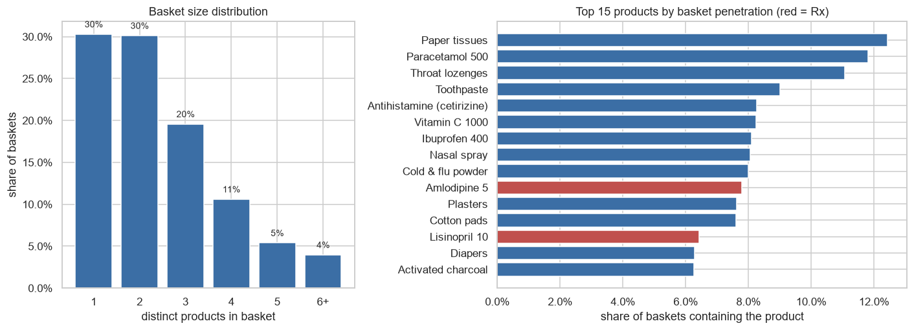
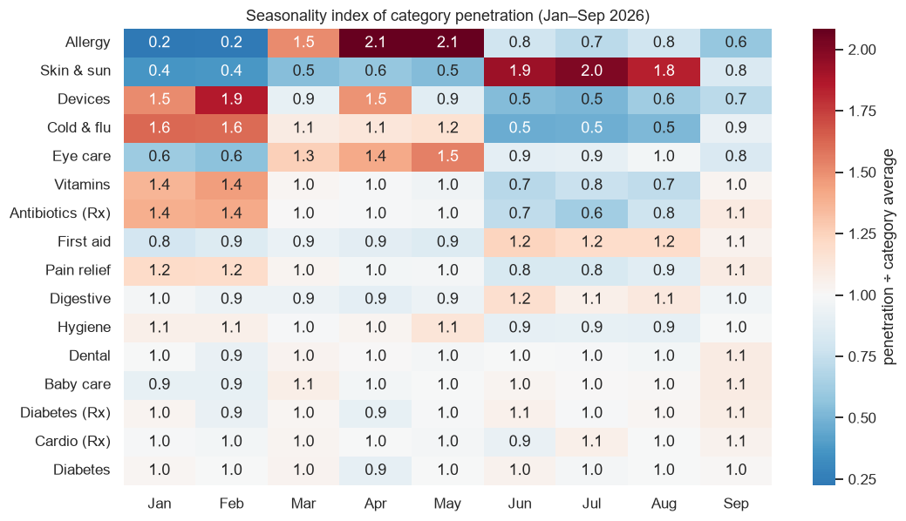
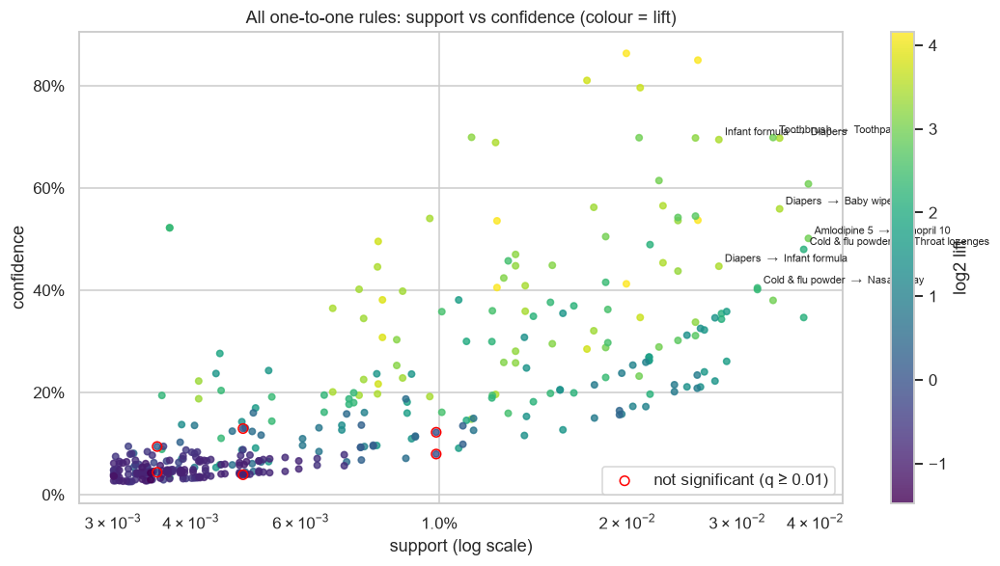
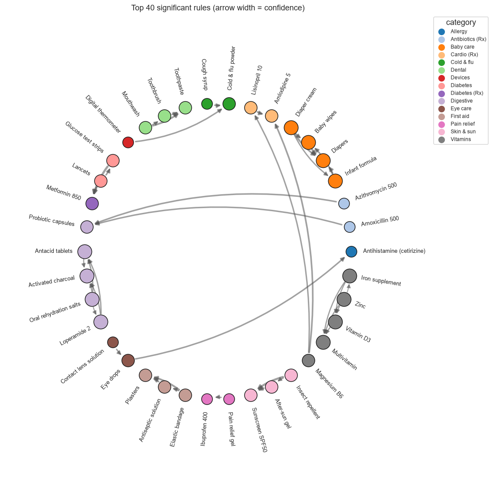
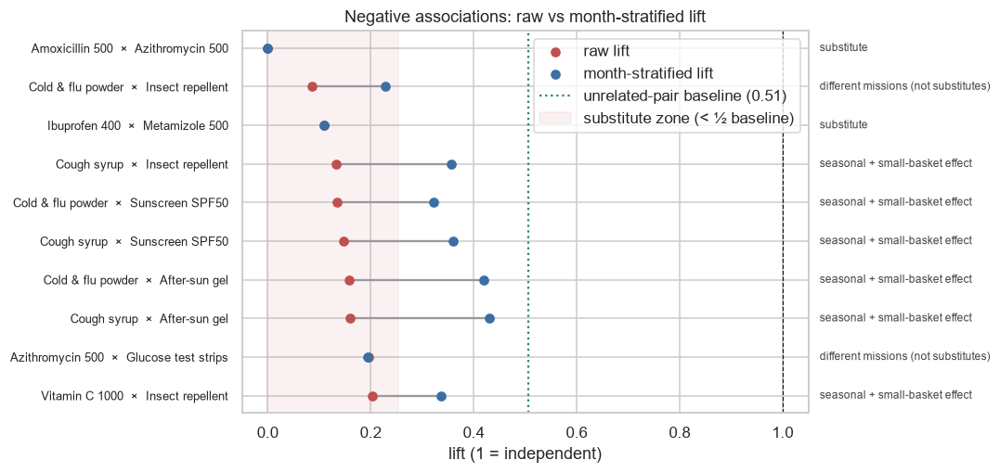
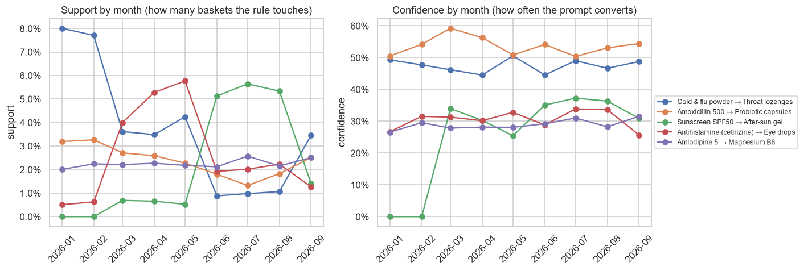
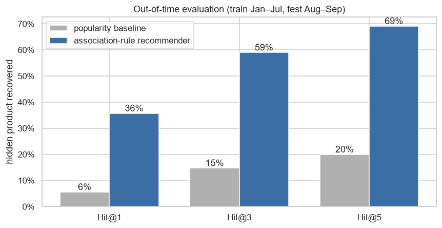
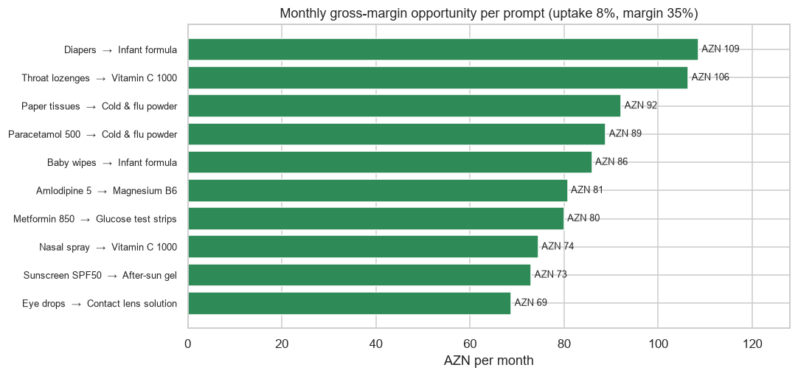

# Baku Pharmacy Chain — Market Basket Analysis & Cross-Sell Recommender

**Daily Data Analytics Project · Day 09**

## Business question
A 6-store Baku pharmacy chain wants to grow basket value **without discounting**. **Which products are genuinely bought together, which only look related (or unrelated) because of the season, which are true substitutes, and how much would pharmacist prompts / POS suggestions earn?**

What the project does:
1. Cleans point-of-sale lines (returns, double scans) and validates them against the master data.
2. Basket KPIs and EDA: basket size, top products, category seasonality.
3. **Apriori implemented from scratch** in NumPy → association rules with support, confidence, lift, leverage and conviction, plus a **2×2 χ² test with Benjamini–Hochberg FDR**, so only rules that are not noise survive.
4. Separates **true substitutes** from **seasonal artefacts** with a month-stratified lift benchmarked against unrelated pairs.
5. A rule-based **top-3 recommender**, evaluated **out-of-time** (train Jan–Jul, test Aug–Sep) against a best-seller baseline.
6. Sizes the cross-sell opportunity in AZN for OTC products only. Prescription drugs are never prompted.

## Key KPIs (from the executed notebook)
| KPI | Value |
|---|---|
| Baskets (Jan–Sep 2026) / stores / products | 47,866 / 6 / 49 |
| Revenue | AZN 937,096 |
| Average basket value / distinct products per basket | AZN 19.58 / 2.45 |
| Single-item baskets | **30.3%** (avg AZN 6.95 vs 16.56 for two-item baskets) |
| Baskets containing an Rx item | 22.1% |
| Data cleaning | 180 return lines + 95 duplicate scans removed (117,472 → 117,197 lines) |
| Frequent itemsets (min support 0.3%) | 308 (49 singles, 190 pairs, 69 triples) |
| Rules generated → significant & actionable | 794 → **326** (q < 0.01, lift ≥ 1.5, confidence ≥ 20%) |
| Recommender Hit@3, out-of-time | **59.0%** vs 14.7% for best-sellers (**4.0×**); Hit@1 35.7% vs 5.6% |
| Top-10 prompts, at 8% uptake | +AZN 2,454 revenue / **+AZN 859 gross margin per month** (≈ AZN 10.3k per year) |

## Charts
### Basket size and top products


### Category seasonality


### All one-to-one rules: support vs confidence (colour = lift)


### Rule network: customer "missions"


### Substitutes or seasonal artefacts?


### The association is stable, the traffic is seasonal


### Recommender vs best-seller baseline (out-of-time)


### Cross-sell opportunity per prompt


## Findings & recommendations
| Area | Evidence | Recommendation |
|---|---|---|
| Basket size | 30.3% of baskets hold a single product; ABV AZN 19.58 | Target single-item baskets with one scripted prompt at the till |
| Significant rules | 326 of 794 rules pass FDR + lift + confidence filters (144 unique item sets) | Act only on FDR-controlled rules; re-mine quarterly |
| Cross-category bridge | Amoxicillin → probiotic: confidence 54%, lift 9.7 | Pharmacist script: offer a probiotic with every antibiotic |
| Chronic care | Amlodipine → Magnesium B6: confidence 29%, lift 7.9; diabetes trio (metformin, strips, lancets) lift ≈ 18 | "Monthly refill" bundles (Rx + supplement/consumables) for loyalty members |
| Seasonality | Cold & flu powder → lozenges: monthly confidence 45–51%, but support swings 9× (January vs summer) | Keep the prompt list fixed, rotate endcaps: cold & flu (Nov–Mar), allergy (Apr–May), sun (Jun–Aug) |
| Substitutes | Amoxicillin × Azithromycin and Ibuprofen × Metamizole: stratified lift ≤ 0.11 vs unrelated-pair baseline 0.51 | Never cross-sell substitutes; shelve them side by side as a choice (generic vs brand) |
| False "substitutes" | 8 of the 10 most negative pairs are not substitutes: 6 are season + small-basket effects (e.g. cough syrup × insect repellent, raw lift 0.13 → stratified 0.36), 2 are different missions | Stratify by season and compare with unrelated pairs before calling products substitutes |
| Recommender | Hit@3 59% vs 15% for best-sellers (4.0×), tested out-of-time | Put rule-based top-3 suggestions on the POS screen |
| Money | Top-10 prompts ≈ AZN 859 gross margin per month at an assumed 8% uptake | A/B test the prompts by store (3 vs 3 stores, 4 weeks) to measure real uptake before scaling |

**Bottom line:** baskets follow clear customer missions. A short, statistically validated prompt list (baby-care add-ons, cold & flu add-ons, chronic-care refills, antibiotic → probiotic) beats best-seller suggestions by about 4× out-of-time. Roll it out through a store-level A/B test so the 8% uptake assumption gets replaced with a measured number.

## Methods
- **Apriori** (`basket.apriori`): level-wise candidate generation (join itemsets that share k−2 items), Apriori pruning (every (k−1)-subset must be frequent) and vectorised support counting on a boolean basket × product matrix.
- **Rules** (`basket.rules`): support, confidence, lift, leverage, conviction; χ² statistic from the 2×2 table of A vs B, p-values adjusted with a hand-written **Benjamini–Hochberg** procedure.
- **Month-stratified lift:** Σ observed / Σ expected, with the expectation computed inside each month, which removes associations that come only from seasonality. With about 2.5 products per basket, unrelated products sit near lift 0.5 rather than 1, so the "no relationship" baseline is the median stratified lift of cross-category pairs.
- **Recommender:** for the current basket, score each unseen OTC product by the highest confidence among matching rules (antecedent ⊆ basket) and fill the rest with best-sellers. Evaluation hides one random product from each Aug–Sep basket (≥ 2 OTC items) and checks whether it appears in the top-k.
- **Opportunity:** baskets with A but not B per month × uptake (8%) × price of B × gross margin (35%). Both rates are stated assumptions (`basket.UPTAKE`, `basket.GROSS_MARGIN`).

## Tech stack
Python · pandas · NumPy (**Apriori from scratch**, matrix co-occurrence) · SciPy (χ²) · matplotlib · seaborn · nbformat / nbconvert

## Structure
```
data/generate_data.py          synthetic POS generator (seed 42): mission-based baskets with seasonality
data/products.csv              49 products (category, list price, Rx flag)
data/baskets.csv               47,866 baskets (timestamp, store, loyalty card)
data/basket_lines.csv          117,472 raw lines (incl. injected returns & double scans)
basket.py                      cleaning, Apriori, rules + FDR, stratified lift, recommender & evaluation
build_notebook.py              builds the analysis notebook
market_basket_analysis.ipynb   executed analysis
images/                        charts
```

## Run
```bash
pip install -r requirements.txt
python data/generate_data.py
python build_notebook.py
python -m nbconvert --to notebook --execute --inplace market_basket_analysis.ipynb
```

> **Note:** all data is synthetic (fixed random seed). It does not describe any real pharmacy, customer or prescription. Product names are generic and do not refer to brands.

## 🇦🇿 Azərbaycanca xülasə
Bakıda 6 filiallı aptek şəbəkəsinin 9 aylıq 47,866 səbəti (sintetik data) təhlil olunub. Məqsəd endirim etmədən səbət dəyərini artırmaqdır. Səbətlərin **30.3%-i tək məhsulludur**, orta səbət 19.58 AZN-dir. Apriori alqoritmi sıfırdan (NumPy ilə) yazılıb. 794 qaydadan χ² testi və Benjamini–Hochberg FDR süzgəcindən sonra **326 etibarlı qayda** qalıb. Ən güclü əlaqələr müştəri "missiyaları"nı göstərir: antibiotik → probiotik (54%), təzyiq dərmanı → Maqnezium B6, diabet üçlüyü (metformin, test zolaqları, lansetlər), uşaq qidası → uşaq bezləri. Mövsümi təsir ayrıca yoxlanılıb: qayda gücü (confidence) il boyu sabitdir, amma satış həcmi qış ilə yay arasında 9 dəfə dəyişir. Ona görə tövsiyə siyahısı sabit qalmalı, vitrinlər isə mövsümə görə dəyişməlidir. Ay üzrə stratifikasiya edilmiş lift göstərir ki, yalnız eyni ehtiyacı ödəyən cütlər (iki antibiotik, iki ağrıkəsici) həqiqi əvəzedicidir. Mənfi əlaqəli digər cütlərin çoxu mövsüm və kiçik səbət effektidir. Qaydalara əsaslanan tövsiyə sistemi zaman üzrə ayrılmış testdə gizlədilmiş məhsulu **59%** hallarda tapır (ən çox satılanlar siyahısında bu göstərici 15%-dir, yəni 4 dəfə yaxşı). Top-10 təklif 8% qəbul fərziyyəsi ilə ayda təxminən **859 AZN** əlavə mənfəət gətirir. Bu fərziyyəni dəqiqləşdirmək üçün filiallar üzrə A/B test tövsiyə olunur.
